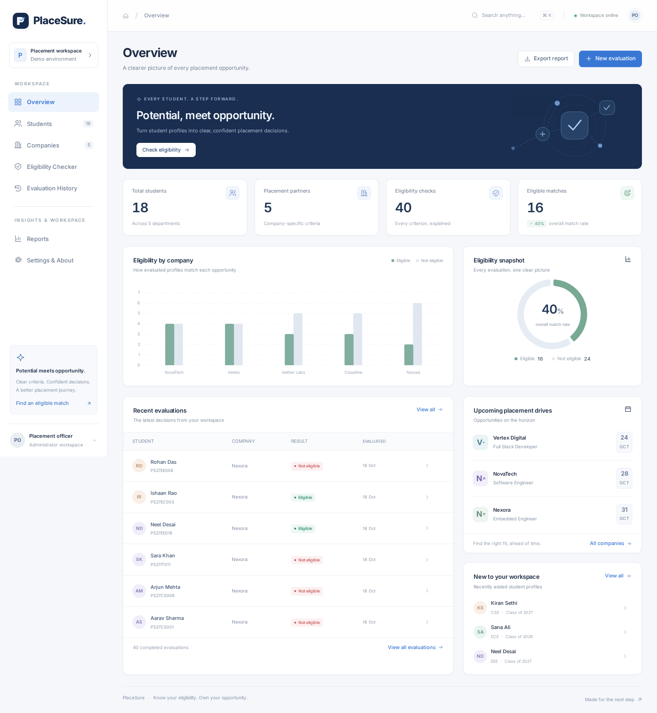

# PlaceSure — Placement Eligibility Checker

### Know Your Eligibility. Own Your Opportunity.

A complete Java/JDBC placement-officer workspace with explainable eligibility decisions, normalized MySQL storage, a responsive SaaS-style interface, immutable evaluation snapshots, and shareable reports.

> **Demonstration data is fictional.** The demo imports 18 students and 5 company opportunities. Running with `--seed-demo` computes 40 actual evaluations through the Java eligibility engine. No chart or eligibility result is hardcoded in the frontend.
>
> Eligibility means satisfaction of the configured criteria. It does **not** guarantee shortlisting, an interview, or a job offer.



## 1. Project overview & problem statement

Placement teams often compare spreadsheets of student marks, arrears, departments, and skills against different employer requirements. Manual checking is repetitive, inconsistent, and difficult to explain later. PlaceSure keeps the profiles and criteria in a database, evaluates them consistently in Java, and preserves an understandable record of each decision.

## 2. Objectives

- Make company-specific eligibility easy to configure and check.
- Explain **every** pass and failure, not just the first failure.
- Keep database storage, business rules, and interface code separate.
- Preserve historical decisions even when profiles or company criteria change.
- Provide useful dashboard insights and accurate, safely exported reports.
- Remain simple enough for a third-year CSE student to demonstrate and explain.

## 3. Implemented features

| Area | Implemented behavior |
|---|---|
| Overview | Database totals, company comparison chart, eligible/ineligible donut, recent checks, upcoming drives, recent students, quick actions |
| Students | Create, view, edit, confirm-delete, unique register numbers, skill tags, search, department/CGPA/arrears filters, sorting, pagination |
| Companies | Complete CRUD, independent criteria, optional historical-arrears rules, normalized skills/departments/years, search, filters, drive dates and packages |
| Eligibility Checker | Searchable selectors, compact profile/criteria previews, backend-only evaluation, every criterion explained, persisted results, CSV and print |
| Evaluation History | Student search, company/status/date filters, pagination, complete snapshot details, export and print |
| Reports | Student-wise, company-wise eligible, company-wise ineligible, failed-criterion analysis, overall summary, evaluation history |
| Settings & About | Actual connection health, Java/database information, local page-size preference, downloadable guides |
| Shared UX | Responsive sidebar, accessible dialogs, confirmation flows, loading/empty/error states, toasts, Cmd/Ctrl+K global search |

There is **no authentication or login** in this focused single-officer project. No unrelated college-management modules are included.

## 4. Technology stack

- **Java 17+**, compiled with Maven's `release=17`.
- JDK's lightweight **`com.sun.net.httpserver.HttpServer`**; no Spring or application-server installation.
- **MySQL 8.0+**, InnoDB, UTF-8; **JDBC** through MySQL Connector/J 8.4.0.
- **MariaDB 10.6+** is a compatible alternative. The supplied environment was actually tested with **MariaDB 11.8.6**, not an Oracle MySQL server.
- Plain HTML5, CSS3, and JavaScript. No frontend build pipeline.
- Locally bundled **Chart.js 4.4.8** and **Inter** fonts. No CDN requests at runtime.
- Jackson 2.18.3 for JSON; JUnit 5.11.4 for tests.
- CSV export plus browser printing/**Save as PDF**. No paid PDF service.

**Verified environment:** Debian 13, OpenJDK 21.0.12.1, Maven 3.9.9, MariaDB 11.8.6, Python 3.13, and Chromium through Playwright 1.64.0. Java bytecode targets 17; Java 17 itself and other database/server versions were not separately executed in this environment.

## 5. System architecture

```text
Browser: HTML / CSS / JavaScript / local Chart.js
                  │ same-origin REST / JSON
                  ▼
HTTP controllers → input validation → services → JDBC DAOs → MySQL
                                         │
                                 EligibilityService
                           BigDecimal + List / Map / Set
                                         │
                       atomic evaluation + detail snapshots
```

JavaScript displays results returned by Java. It does not reproduce the eligibility algorithm. Controllers handle HTTP, services handle business rules, and DAOs handle prepared SQL statements. Immutable Java records encapsulate model data.

See [Architecture](docs/ARCHITECTURE.md), [Database design](docs/DATABASE.md), and [API reference](docs/API.md).

## 6. Project structure

```text
PlaceSure/
├── frontend/
│   ├── index.html
│   ├── css/style.css
│   ├── js/{app.js,chart.umd.js,Chart-LICENSE.md}
│   └── assets/                 # local Inter fonts, logo/favicon, license
├── src/
│   ├── main/java/com/placesure/
│   │   ├── App.java
│   │   ├── config/             # configuration, JDBC connection, explicit demo seeder
│   │   ├── model/              # immutable Student, Company, Criteria, Evaluation, Report
│   │   ├── dao/                # parameterized database queries and mappings
│   │   ├── service/            # validation, eligibility, report generation
│   │   ├── controller/         # router and REST controllers
│   │   └── util/               # JSON, validation, CSV, JDBC transaction helpers
│   ├── main/resources/
│   └── test/java/com/placesure/
│       ├── service/EligibilityServiceTest.java
│       ├── util/ValidationAndCsvTest.java
│       └── integration/DatabaseIntegrationIT.java
├── database/
│   ├── database.sql            # runnable schema + 18 students + 5 companies
│   └── schema.sql              # schema only for an empty workspace
├── scripts/                    # build, run, Windows launcher, safe fresh-DB setup
├── tests/                      # HTTP, Chromium, empty-state verification scripts
├── docs/                       # architecture, database, API, viva, test results, screenshots
├── reports/                    # executed logs and sample CSV/PDF reports
├── releases/placesure.jar       # prebuilt runnable JAR, dependencies and UI included
├── .env.example
├── .gitignore
├── pom.xml
└── README.md
```

`target/` is generated by Maven. `.runtime/` holds temporary running-JAR copies and browser-test artifacts. `.env`, runtime files, and build caches are not included in the downloadable source archive.

## 7. Database design & relationships

| Table | Purpose |
|---|---|
| `students` | Identity, register number, department, graduation year, CGPA, active and historical arrears |
| `companies` | Employer/opportunity profile, job role, optional drive date, package, advisory notes |
| `company_criteria` | One criteria row per company; mandatory minimum CGPA and maximum active arrears, nullable historical maximum |
| `skills` | Master skill names with a unique constraint |
| `student_skills` | Student-to-skill many-to-many mapping |
| `company_required_skills` | Company-to-required-skill mapping |
| `company_departments` | Optional allowed departments |
| `company_graduation_years` | Optional accepted graduation years |
| `evaluations` | Final outcome, counts, timestamp, original source IDs, identity fields, profile/criteria JSON snapshots |
| `evaluation_details` | Per-rule requirement, actual-value, outcome, explanation, and display-order snapshots |

Primary keys, foreign keys, uniqueness, CHECK constraints, and query indexes are included. Skills and criteria mappings cascade when their owner is deleted. Evaluation references become `NULL` on owner deletion, while original source IDs and snapshots remain available.

**History is immutable through the application**, not cryptographically tamper-proof against a database administrator. Existing evaluation records are never recalculated on read.

## 8. Eligibility algorithm

1. Start a **repeatable-read JDBC transaction**.
2. Retrieve the selected student, company, and normalized criteria from the database.
3. Check mandatory profile identity/academic information.
4. Compare CGPA using `BigDecimal.compareTo`: actual **≥** minimum.
5. Check active arrears: actual **≤ maximum permitted count**. This is not an equality rule.
6. If configured, check historical arrears against their own maximum.
7. Normalize skill whitespace/case, build a `Set`, and collect **all** missing required skills. `Java` does not match `JavaScript`; `C` and `C++` are distinct.
8. Apply department and graduation-year restrictions only when their lists are nonempty.
9. Produce a PASS/FAIL row and plain-language explanation for every configured criterion.
10. Final result is eligible **only when no detail has failed**. Missing/invalid mandatory data or criteria cannot succeed.
11. Save the summary and all detail/profile/criteria snapshots, then commit. Roll back on failure.

Both CGPA and maximum active arrears are mandatory company criteria. Blank history maximum, department list, graduation list, or skill list means that optional restriction is **not configured**. A history maximum of **0 is configured** and permits no historical arrears. Additional notes are advisory, not executable rules.

Student profiles still require name, register, email, department, graduation year, CGPA, and valid arrears counts. Disabling a company restriction does not make an incomplete mandatory student profile valid.

Historical arrears mean **previously held arrears**, recorded separately from currently active/uncleared subjects. They are not automatically calculated from the active count.

## 9. Setup requirements

For the prebuilt JAR:
- Java **17 or later**.
- A running MySQL 8.0+ or compatible MariaDB 10.6+ server.
- A modern browser.

To rebuild: Maven 3.8+ and a JDK 17+; internet access for the first dependency download. Python/Playwright are needed **only for optional browser tests**, not to run PlaceSure.

### Debian/Ubuntu development prerequisites

```bash
sudo apt-get update
sudo apt-get install default-jdk maven mariadb-server python3
java -version                    # ensure version 17+
sudo service mariadb start       # or systemctl start mariadb on a normal host
```

The sandbox demonstration used the lightweight Java server and a locally started MariaDB process because neither Maven nor a database server was initially installed.

## 10. Database creation

### Option A — safe fresh local setup (Unix socket-root access)

From the project root:

```bash
python3 scripts/setup-local-db.py --with-tests
```

This creates fresh databases, an application user with restricted application-DB permissions, a separate test database, random local credentials in an ignored **`.env` with mode 600**, and imports fictional input data. It **refuses to overwrite an existing database, user, or configuration file**.

For a fresh empty workspace, use `--empty` instead of importing the demo profiles. Run without `--seed-demo` to keep it empty.

The automated setup script was actually executed against a scratch database; the restricted app user successfully read 18 students and 5 companies afterward.

### Option B — manual MySQL setup (also suitable for Windows)

Log in using a database administrator:

```sql
CREATE DATABASE placesure CHARACTER SET utf8mb4 COLLATE utf8mb4_unicode_ci;
CREATE USER 'placesure_app'@'127.0.0.1' IDENTIFIED BY 'replace-with-a-strong-local-password';
CREATE USER 'placesure_app'@'localhost' IDENTIFIED BY 'replace-with-a-strong-local-password';
GRANT SELECT, INSERT, UPDATE, DELETE ON placesure.* TO 'placesure_app'@'127.0.0.1';
GRANT SELECT, INSERT, UPDATE, DELETE ON placesure.* TO 'placesure_app'@'localhost';
```

Import using the **admin** account, which has CREATE permissions:

```bash
mysql -u root -p placesure < database/database.sql
# Debian MariaDB socket-authenticated alternative:
sudo mariadb placesure < database/database.sql
```

Import **once into a new database**. `database.sql` does not drop existing data; repeating its explicit sample inserts would correctly raise duplicate-key errors. For no demo profiles, import `database/schema.sql` instead. Evaluation results are not invented in SQL: Java computes them when you run `--seed-demo`.

## 11. Configuration

```bash
cp .env.example .env
# Edit .env and enter the password you chose above.
```

```dotenv
DB_URL=jdbc:mysql://127.0.0.1:3306/placesure?useSSL=false&allowPublicKeyRetrieval=true&connectionTimeZone=UTC&forceConnectionTimeZoneToSession=true&characterEncoding=UTF-8
DB_USER=placesure_app
DB_PASSWORD=your-own-local-password
PORT=8080
BIND_HOST=0.0.0.0
```

These are examples, **not supplied login credentials**. The archive contains no real password. OS environment variables override `.env`. Run from the project root so the local configuration is found. Keep `.env` private and excluded from version control.

`useSSL=false` is appropriate only for a trusted local demonstration; configure TLS for remote database deployments. Binding to `0.0.0.0` enables the live preview. Bind to `127.0.0.1` for a strictly local installation when a proxy is not needed.

## 12. Build & run

### Quick run using the included JAR

```bash
./scripts/run.sh --seed-demo
# or, without a shell launcher:
java -jar releases/placesure.jar --seed-demo
```

Open **http://localhost:8080**. In Arena, open the **PlaceSure live preview**.

`--seed-demo` creates evaluations only when the evaluation table is empty and student/company data exists. On the provided dataset, it computes 40 decisions: **16 eligible and 24 not eligible**. These are reproducible engine outputs, not frontend constants. Subsequent real checks naturally change the counts. Omitting the flag never auto-fills an empty history.

### Build from source

```bash
./scripts/build.sh              # runs the unit tests, packages, copies the release JAR
./scripts/run.sh --seed-demo
# Equivalent direct Maven commands:
mvn clean package
java -jar target/placesure.jar --seed-demo
```

Windows:

```bat
mvn clean package
java -jar target\placesure.jar --seed-demo
```

`scripts/run.bat` can launch a prebuilt release. No frontend install/build command is necessary. All assets and dependencies are packaged into the shaded JAR; after building once, the application needs no CDN or Maven connection.

**Stop with Ctrl+C before directly overwriting a running JAR.** The Unix launcher makes a private runtime copy so a new build cannot corrupt a live classloader. Restart after backend changes; editing source is not Java hot reload.


## Deploy to Render

Render deployment files are now provided: `Dockerfile`, `.dockerignore`, `render.yaml`, a private MySQL image/bootstrap, and a tested startup wrapper. Read [Render deployment guide](docs/DEPLOY-RENDER.md) before applying them.

- Selected default (`render.yaml`): **free Render web service using your existing external MySQL**. You must configure the database secrets and import the SQL into a dedicated empty database first.
- Optional paid alternative (`deploy/render-with-private-mysql.yaml`): Java web service + private MySQL 8.4 + persistent disk. This is NOT the selected default; review costs before applying it.
- All three blueprint files pass the official Render JSON Schema; 17 wrapper tests and a real local launch passed.
- **Not yet deployed to Render:** a repository URL, account authorization, and approval of any billable resources are still required. Docker/remote builds have not run.
- Keep all public deployment data fictional until authentication and institutional safeguards are added.

## 13. How to use the application

1. **Overview:** review actual database totals, company comparison bars, recent decisions, and upcoming dates. Export an overall summary or start a new evaluation.
2. **Students:** add a profile, press Enter/comma to add skill tags, and save. Use filters and sorting to find a profile. Open the eye icon/name to view details, the pencil to edit, and the bin to confirm deletion.
3. **Companies:** create an opportunity and configure academic criteria. Specify **maximum** active arrears. Check “Consider historical arrears” only when needed. Empty optional lists mean no restriction. View all requirements before checking a match.
4. **Eligibility Checker:** search/select a student and company; review the previews; click **Check eligibility**. The result explains every configured rule and is saved automatically.
5. **Evaluation History:** search/filter previous decisions and open their immutable breakdown. Changing a current profile never changes this saved explanation.
6. **Reports:** choose one of six report types, apply company/student/department/status/date filters, then export or print.
7. **Settings & About:** check connectivity, choose a student-table page size, or download project resources.
8. Press **Cmd/Ctrl+K** for cross-workspace search. Use Escape to close dialogs. Mobile navigation opens with the menu icon.

### Printing and PDF

Choose **Print / Save PDF** on a result or report. A clean standalone report opens in a new tab with a print button. Choose your browser's **Save as PDF** destination. Allow pop-ups for PlaceSure if blocked. This is browser-assisted PDF export, not a separate server-generated PDF endpoint. Example PDFs are included in `reports/`.

### Reporting semantics — important for an accurate demo

- Dashboard, history, overall summary, and failed-criterion analysis count **all completed evaluation attempts**.
- Student-wise and company-wise eligible/ineligible reports select the **latest saved result per original student–company pair**, as of the selected end date. A newer failure supersedes an older pass for those match lists.
- Company criteria changes do not silently re-evaluate students. Run another check to record a new decision.
- Reports use stored identity and criterion snapshots, including for deleted profiles/companies. Original IDs remain available in report filters.
- Dates filter **inclusive UTC calendar days**. Timestamps display in the browser's local timezone. CSV timestamp headings explicitly say UTC.
- Reports are capped at **10,000 matching evaluations**. A readable error asks for narrower filters instead of silently truncating results.
- CSV uses UTF-8 with a BOM, CRLF rows, quoted/escaped cells, and formula neutralization. Title, generation time, filter scope, and column headings are included.

## 14. Sample eligibility scenarios

These scenarios refer to the provided fictional inputs; use the checker to compute a new saved result.

| Student → opportunity | Expected result | Why |
|---|---|---|
| Aarav Sharma → NovaTech | Eligible | 8.72 CGPA, zero active/historical arrears, Java/SQL/Git, permitted department and year |
| Arjun Mehta → NovaTech | Eligible | CGPA is exactly the 7.00 minimum; history count 2 is within maximum 2 |
| Dev Kapoor → NovaTech | Not eligible | Low CGPA, excess active/history arrears, and missing required skills; all failures are shown |
| Meera Iyer → Nexora | Eligible | Required C and C++, qualifying ECE profile, no arrears, accepted year |
| Sana Ali → Aether Labs | Not eligible | Other criteria match, but graduation year 2028 is not accepted |
| Kavya Nair → Vertex Digital | Eligible | 6.80 ≥ 6.50, one active arrear permitted, web skills present; historical arrears are not considered |

## 15. Testing instructions & executed results

### Unit tests — no database needed

```bash
mvn test
```

### Real JDBC integration tests — isolated database required

Create a separate test database and grant schema-management permissions **only on that test database**:

```sql
CREATE DATABASE placesure_test CHARACTER SET utf8mb4 COLLATE utf8mb4_unicode_ci;
GRANT ALL PRIVILEGES ON placesure_test.* TO 'placesure_app'@'127.0.0.1';
GRANT ALL PRIVILEGES ON placesure_test.* TO 'placesure_app'@'localhost';
```

Add `TEST_DB_URL`, `TEST_DB_USER`, and `TEST_DB_PASSWORD` to `.env` using `.env.example`. The database name **must be `placesure_test`**. Integration tests intentionally create/clear test data and verify the catalog before modifying it. Never point tests at valuable data.

```bash
mvn -Pintegration verify
```

### HTTP and Chromium workflows (optional)

```bash
python3 -m pip install -r tests/requirements.txt
python3 -m playwright install --with-deps chromium
# Separate terminal: an isolated test instance with fictional inputs and actual evaluations
python3 tests/run_test_server.py --reset-demo
# Another terminal: deliberately broken DB instance for error-screen verification
python3 tests/run_test_server.py --unavailable
# Then execute:
python3 tests/api_smoke.py
python3 tests/browser_smoke.py
```

The isolated test servers use ports **8081** and **8082**, not the main app on 8080. Stop them with Ctrl+C when finished. To verify empty-workspace UI, run `mvn -Pintegration verify` while the isolated test server is idle (the tests leave its database empty), then `python3 tests/empty_state_smoke.py`. Restart the test server with `--reset-demo` before subsequent populated workflow runs.

### Actual final results

| Executed suite | Passed | Failed / errors / skipped |
|---|---:|---|
| JUnit eligibility, validation, CSV tests | **45** | **0 / 0 / 0** |
| Real JDBC integration tests | **16** | **0 / 0 / 0** |
| HTTP API workflow/security/export checks | **20** | **0 failed** |
| Chromium browser workflow checks | **27** | **0 failed** |
| Real empty-database page checks | **7** | **0 failed** |

Browser coverage includes all **7 pages × 3 viewports = 21 combinations** (1440×1000 desktop, 768×1024 tablet, 390×844 mobile), actual PDF output, XSS escaping, delete cancellation, and a real unreachable-database screen. Concurrent database checks, snapshot retention, all-failure reporting, maximum supported skill snapshots, and transaction rollback were also executed.

Raw execution logs are in `reports/*-test-run.txt`. The requirement-to-test mapping and honest environment limitations are in [Executed test results](docs/TEST-RESULTS.md). These counts are actual runs, not estimated coverage or a guarantee of production readiness.

## 16. Security & reliability

- Prepared statements bind SQL values; sort columns are allowlisted.
- Backend validates even when HTML validation exists. Fractional counts, invalid CGPAs, missing fields, duplicate registers, malformed filters, and invalid IDs receive suitable HTTP errors.
- Transactions cover profile/criteria mapping writes and complete evaluation persistence.
- Repeatable-read snapshots keep multi-query evaluation/report reads consistent.
- Credentials are read from the environment or ignored `.env`; never returned to the UI.
- User-controlled HTML is escaped, including table cells, tag values, modals, and print documents.
- CSV cells are quoted and formula-safe.
- Browser mutation requests reject a mismatched Origin; this is **not a substitute for authentication**.
- Request bodies are limited to 64 KB. Database timeouts and safe connection-help screens are provided.
- Deletions require a UI confirmation; completed evaluation history remains available.
- The API does not expose stack traces or database connection strings.

## 17. Troubleshooting

| Symptom | What to check |
|---|---|
| Database unavailable screen | Start MySQL/MariaDB; verify DB_URL/user/password; import the schema; restart the app |
| Access denied | Confirm the password and correct `127.0.0.1`/`localhost` database grants |
| Unknown database/table | Run database creation and import as an administrator |
| Port already in use | Stop the existing Java process or change PORT in `.env` |
| Unsupported class version | Install Java 17+ and check which `java` is on PATH |
| Maven download failure | Retry with network access, or run the included prebuilt JAR |
| No data in charts | Add profiles/companies and run actual checks, or use the explicit demo seed flag |
| Old match after editing criteria | History is deliberately preserved; run a new evaluation |
| Print tab blocked | Allow pop-ups for the application; use its print button |
| Directly opening index.html fails | Run the Java server; the UI needs its same-origin API |
| Changes not reflected after rebuilding | Stop/restart the backend; source edits are not Java hot reload |

## 18. Known limitations

- Focused **single-officer, unauthenticated** application; not ready for public institutional deployment without login, TLS, authorization, audit/retention policy, and operational backups.
- Only configured academic, skill, department, and graduation rules are automatic. Free-text notes, aptitude tests, interview performance, and shortlisting are outside scope.
- Historical snapshots remain after deletion by design; institutions need an explicit privacy/retention policy before using real student data.
- One company record represents one role/drive and its criteria. Separate opportunities can be added as separate records.
- Latest-write-wins profile editing; no optimistic-lock conflict UI or bulk import.
- Per-operation JDBC connections and small, understandable DAO queries are appropriate for this demo, not tuned for millions of profiles. Metadata selectors load the directory into memory; report rows are capped at 10,000.
- Browser-assisted PDF; no headless PDF engine is required by the application.
- Schema supports MySQL 8; execution here used MariaDB 11.8. Cross-browser testing beyond Chromium, actual phone hardware, and a standalone Java 17 runtime were not performed.
- No email notifications, student portal, authentication roles, live company feeds, or machine-learning predictions are claimed.

## 19. Future enhancements

1. Proper institutional authentication and authorization.
2. Audited bulk CSV import with preview and duplicate resolution.
3. Student consent, retention schedules, backup/restore, and tamper-evident audit trails.
4. JDBC connection pooling and indexed server-side autocomplete for larger directories.
5. Versioned criteria sets and explicit bulk re-evaluation.
6. Optional server-generated PDFs and accessible export templates.
7. Additional documented, testable company rules such as school marks or education gaps.

## 20. Viva preparation & third-party assets

Start with the short [Viva notes](docs/VIVA.md). For a five-minute demonstration: overview → student → company criteria → eligible and ineligible checks → saved history → CSV/PDF report → explain the Java service and normalized tables.

Chart.js is bundled under MIT (`frontend/js/Chart-LICENSE.md`). Inter is bundled under the SIL Open Font License (`frontend/assets/Inter-LICENSE.txt`). Application icons and layout are original inline SVG/CSS; no remote imagery is required.
